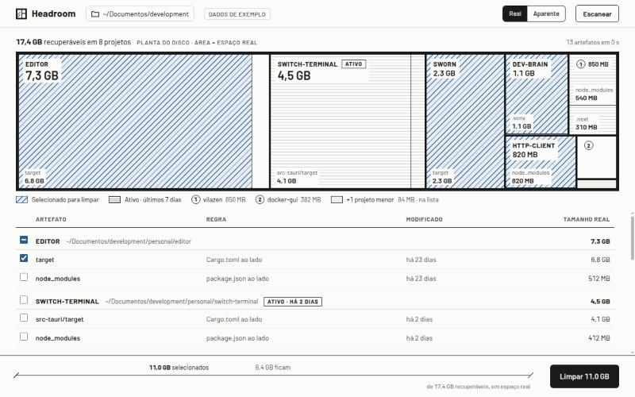

# Headroom

App desktop para Linux que acha os `node_modules`, `target`, `.venv` e caches dos seus projetos, mostra quanto espaço cada um ocupa de verdade e apaga o que você escolher, sem tocar em código-fonte.



<sub>Dados de demonstração. A interface é em português do Brasil.</sub>

## Por que o Headroom

- **Só aparece o que uma regra aprova.** Um `node_modules` só conta com um `package.json` ao lado, e um `target` só com um `Cargo.toml` ao lado. Uma pasta não entra na lista só por ter o nome certo. Cada item mostra a evidência que o aprovou.
- **O número é o espaço que volta.** O tamanho real conta blocos em disco e trata hardlinks. Um `node_modules` do pnpm, que é quase todo ligado ao store global, aparece com os poucos MB que de fato libera, não com o tamanho aparente.
- **Revalida antes de apagar.** A tela só manda ids da última varredura, nunca caminhos. Antes de apagar, o backend confere de novo cada pasta: ainda existe, não virou link simbólico, não saiu da pasta varrida e a regra continua valendo. O que falhar não é apagado, e você vê o motivo.
- **Projeto ativo fica marcado.** Projetos com arquivos editados nos últimos 7 dias levam o selo ATIVO. Dá para apagar mesmo assim, mas a confirmação avisa que o próximo build vai demorar.
- **Rápido.** A varredura da pasta pessoal inteira leva menos de 1 s com o cache do disco aquecido, e os resultados aparecem enquanto ela roda.

## O que ele encontra

| Pasta | Só conta se |
|---|---|
| `node_modules` | existe um `package.json` ao lado |
| `target` | existe um `Cargo.toml` ao lado |
| `.venv`, `venv` | existe um `pyvenv.cfg` dentro |
| `__pycache__`, `.pytest_cache` | sempre (são só cache) |
| `.next`, `.turbo` | existe um `package.json` ao lado |
| `.gradle` | existe um `build.gradle`, `build.gradle.kts` ou `settings.gradle` ao lado |

`dist/` e `build/` ficam de fora, porque às vezes são versionados.

## Como usar

1. Abra o app. Ele já começa a varrer a sua pasta pessoal (`~`).
2. Para varrer outra pasta, clique no botão com o caminho e escolha no seletor do sistema.
3. A planta no topo mostra onde está o espaço. Cada projeto é um cômodo, e os artefatos dele são as divisões internas. Projetos muito pequenos se juntam num cômodo "+N projetos", mas continuam todos na lista.
4. Selecione clicando na planta ou marcando na lista. As duas ficam sincronizadas.
5. **Real / Aparente** alterna entre o espaço que volta e a soma dos tamanhos dos arquivos.
6. **Limpar** mostra a lista exata e o total antes de apagar.

**A exclusão é permanente.** Nada vai para a lixeira, porque no Linux a lixeira fica no mesmo disco e não liberaria espaço. Tudo que o Headroom apaga volta com `npm install`, `cargo build` ou equivalente.

## Instalação

Ainda não há pacotes publicados. Por enquanto, o app é compilado a partir do código.

**Requisitos:**
- Linux
- Rust 1.90 ou mais novo
- Node.js 22 ou mais novo
- As bibliotecas de sistema do Tauri 2. No Debian e no Ubuntu:

```bash
sudo apt install libwebkit2gtk-4.1-dev build-essential curl wget file libxdo-dev libssl-dev libayatana-appindicator3-dev librsvg2-dev
```

Para outras distribuições, veja os [pré-requisitos do Tauri](https://v2.tauri.app/start/prerequisites/).

Depois, rode cada comando na pasta do projeto:

```bash
npm install
```

```bash
npm run tauri build -- --no-bundle
```

O executável fica em `src-tauri/target/release/headroom`.

## Desenvolvimento

| Comando | O que faz |
|---|---|
| `npm run tauri dev` | Abre o app com recarga automática |
| `npm run dev` | Só a interface, no navegador, com os dados de demonstração |
| `npm test` | Testes do layout da planta e dos nomes de projetos |
| `cargo test --manifest-path src-tauri/Cargo.toml` | Testes de regras, medição, varredura e exclusão em árvores reais numa pasta temporária |
| `npm run lint` | Lint do frontend |

Dois testes ficam fora da execução normal e servem para conferir as metas à mão:

```bash
cargo test --release --manifest-path src-tauri/Cargo.toml -- --ignored --nocapture timing
```

O `timing` mede a varredura de `~/Documentos/development` e de `~`, e lista os artefatos achados.

```bash
HEADROOM_VERIFY=~/pasta-de-teste cargo test --manifest-path src-tauri/Cargo.toml -- --ignored --nocapture freed_matches_df
```

O `freed_matches_df` **apaga** todos os artefatos dentro de `HEADROOM_VERIFY` e compara o espaço informado com o que o `df` mostra. Use só numa pasta criada para isso.

**Estrutura:**
- `src-tauri/src/`: o backend em Rust, com `rules.rs`, `measure.rs`, `scan.rs`, `delete.rs` e os comandos em `lib.rs`.
- `src/`: a interface em React e Tailwind.

## Limitações

- **Só Linux.**
- **Pastas ocultas também são varridas.** Isso inclui pastas de ferramentas como `~/.vscode` e `~/.local`, onde a regra pode aprovar, por exemplo, o `node_modules` de uma extensão do editor. Confira a lista antes de limpar a pasta pessoal inteira.
- **Fica no mesmo disco da pasta escolhida.** Não segue links simbólicos e não entra em `.git`.
- **Sem desfazer.**

## Documentação

- [PRODUCT.md](PRODUCT.md): o que o produto é e para quem.
- [DESIGN.md](DESIGN.md): o sistema visual da Planta Baixa.
- [specs/](specs/README.md): PRD, techspec e o histórico de decisões de cada feature.

## Licença

[MIT](LICENSE)
